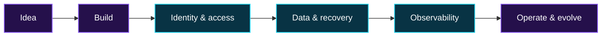

<!--
  ERGODESU / profile transmission
  One file. GitHub-flavored Markdown + GitHub-safe HTML.
  Palette: midnight #080B1F | violet #7C3AED | cyan #58E1FF | pink #F472B6
  The hero, typing effect and icon rows load from public SVG image services.
  Edit the links and text freely. No JavaScript, CSS files or GitHub Actions needed.
-->

<div align="center">

  

  <a href="https://github.com/ergodesu">
    
  </a>

  <br />

  <a href="https://ergodesu.dev/">
    
  </a>
  <a href="https://www.linkedin.com/in/ergodesu/">
    
  </a>
  <a href="mailto:ganbatdesu@gmail.com">
    
  </a>
  <a href="https://github.com/ergodesu?tab=repositories">
    
  </a>

  <br /><br />

  
  
  

</div>

<br />

<!-- ═══════════════════════ ABOUT / CONSOLE ═══════════════════════ -->

## <samp>01 // SIGNAL DETECTED</samp>

<table>
  <tr>
    <td width="56%" valign="top">
      <h3>Hi. I'm <code>ergodesu</code> <code>✦</code></h3>
      <p>
        A developer from Mongolia who likes the entire journey from
        <b>the first line of code</b> to <b>the last recovery drill</b>.
      </p>
      <p>
        I build applications, connect systems, design identity flows,
        modernize legacy platforms, and keep services running when the
        interesting problems begin.
      </p>
      <p><b>Good software works.<br />Great software survives reality.</b></p>
    </td>
    <td width="44%" valign="top">
      <h4><code>~/ergodesu $ cat identity.toml</code></h4>
      <pre lang="toml"><code>[identity]
handle   = "ergodesu"
base     = "Mongolia"
mode     = "build + operate"

[priorities]
security = true
recovery = true
clarity  = true
coffee  = "yes"

[status]
curious  = "always"</code></pre>
    </td>
  </tr>
</table>

<!-- ═════════════════════════ ENGINEERING GRID ═══════════════════ -->

## <samp>02 // ENGINEERING DOMAINS</samp>

<table>
  <tr>
    <td width="50%" valign="top">
      <h3>⚡ <code>01 / APPLICATIONS</code></h3>
      <p>Web platforms, APIs, automation, internal tools, useful interfaces.</p>
      <p><code>Next.js</code> <code>React</code> <code>Flask</code> <code>.NET</code></p>
    </td>
    <td width="50%" valign="top">
      <h3>🔐 <code>02 / IDENTITY</code></h3>
      <p>SSO, authorization, account lifecycle, trustworthy access boundaries.</p>
      <p><code>Keycloak</code> <code>OIDC</code> <code>OAuth 2.0</code> <code>RBAC</code></p>
    </td>
  </tr>
  <tr>
    <td width="50%" valign="top">
      <h3>🛠️ <code>03 / OPERATIONS</code></h3>
      <p>Deployment, monitoring, reverse proxies, backups and recovery.</p>
      <p><code>Linux</code> <code>Docker</code> <code>Nginx</code> <code>Git</code></p>
    </td>
    <td width="50%" valign="top">
      <h3>🗄️ <code>04 / DATA &amp; SYSTEMS</code></h3>
      <p>Databases, storage, migrations, integrations and platform evolution.</p>
      <p><code>PostgreSQL</code> <code>SQL</code> <code>SeaweedFS</code> <code>Odoo</code></p>
    </td>
  </tr>
</table>

<!-- ══════════════════════════ TOOLBOX ══════════════════════════ -->

## <samp>03 // LOADOUT</samp>

<div align="center">

  <sub><b>LANGUAGES &amp; INTERFACES</b></sub><br />
  

  <br /><br />
  <sub><b>FRAMEWORKS &amp; RUNTIME</b></sub><br />
  

  <br /><br />
  <sub><b>DATA, INFRASTRUCTURE &amp; TOOLS</b></sub><br />
  

  <br /><br />
  <sub><i>Tools change. Engineering principles don't.</i></sub>

</div>

<!-- ═══════════════════════ SYSTEM BLUEPRINT ═══════════════════════ -->

## <samp>04 // MENTAL MODEL</samp>

<div align="center">

**A working demo is not a production system.**

</div>



<div align="center">
  <sub>Design the failure path before the failure finds you.</sub>
</div>

<!-- ═══════════════════════ WHAT I BUILD ═════════════════════════ -->

## <samp>05 // CURRENT ORBITS</samp>

| Orbit | What pulls me in |
|:--|:--|
| 🛰️ **Platform engineering** | Making independent services function as a coherent ecosystem |
| 🛡️ **Identity & security** | Authentication, authorization, policy and secure defaults |
| 🧬 **Legacy modernization** | Migrating old systems without throwing away their history |
| 🎓 **Education technology** | Learning platforms, service desks and knowledge systems |
| 🤖 **Automation & AI** | Using tools to remove repetitive work, not critical thinking |

<details>
  <summary><b>🔓 OPEN THE RESTRICTED TERMINAL</b> &nbsp; <sub>optional side quest</sub></summary>
  <br />

  ```text
  $ sudo ./summon-machine-spirit --verbose

  [ OK ] Coffee reserves .......... replenished
  [ OK ] Authentication ........... enforced
  [ OK ] PostgreSQL ............... responding
  [ OK ] Backups .................. verified
  [ ?? ] Sleep schedule ........... under investigation
  [ !! ] Unnecessary complexity ... purged

  > The Emperor protects.
  > But we still take backups.
  ```

  <p><sub>Outside the terminal: Metallica · Rammstein · Otyken · Interstellar · Warhammer 40K · games · cats.</sub></p>
</details>

<!-- ═══════════════════════════ FOOTER ════════════════════════════ -->

<br />

<div align="center">

  <h3>Less noise. More signal.</h3>
  <p><code>BUILD WITH INTENT</code> &nbsp; ✦ &nbsp; <code>SECURE BY DESIGN</code> &nbsp; ✦ &nbsp; <code>OPERATE WITH CONFIDENCE</code></p>

  <a href="https://github.com/ergodesu">
    
  </a>

</div>
