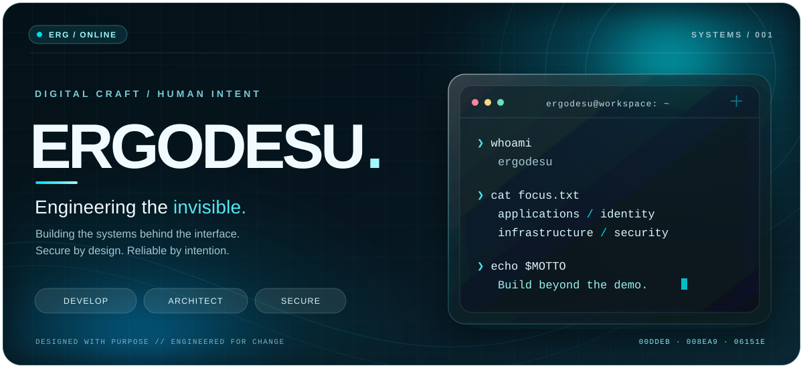

<!--
  ERGODESU / GLASS PROFILE
  Design language: midnight navy #06151E, electric cyan #00DDEB,
  teal #008EA9, deep teal #006780, icy white #EFF6FE, soft cyan #53E7F3.
  The glass effect is pre-rendered in assets/ergodesu-glass.svg because
  GitHub strips CSS and inline SVG from README content.
-->

<div align="center">
  

  <br/>
  <sub>DEVELOPER BY TITLE &nbsp; · &nbsp; SYSTEMS ENGINEER BY INSTINCT &nbsp; · &nbsp; BUILDER BY CHOICE</sub>

  <br/><br/>

  <a href="https://github.com/ergodesu?tab=repositories"><b>Explore repositories</b></a>
  &nbsp; · &nbsp;
  <a href="#selected-disciplines"><b>What I build</b></a>
  &nbsp; · &nbsp;
  <a href="#engineering-principles"><b>How I think</b></a>
</div>

<br/>

<table>
  <tr>
    <td width="61%" valign="top">
      <h3>01 &nbsp; / &nbsp; THE HUMAN SIDE OF THE STACK</h3>
      <p>Hey, I’m <b>Ergodesu</b> — a developer who likes owning the whole journey, not just the interface.</p>
      <p>I think in <b>systems</b>: user experience, APIs, identity, databases, infrastructure, observability, and the recovery plan nobody wants to need.</p>
      <p>My favorite kind of engineering is the kind you don't notice — because it keeps working.</p>
      <p><sub>Based in Mongolia · Always building · Still learning</sub></p>
    </td>
    <td width="39%" valign="top">
      <h3>STATUS &nbsp; / &nbsp; CURRENT MODE</h3>
      <pre lang="text"><code>● SYSTEM ONLINE

$ role
builder / architect

$ principles
secure · simple · durable

$ next
ship something useful_</code></pre>
    </td>
  </tr>
</table>

<br/>

### SELECTED DISCIPLINES

<table>
  <tr>
    <td width="50%" valign="top">
      <h3>◈ &nbsp; Product engineering</h3>
      <p>Human-friendly interfaces with the APIs, services and operational foundations to back them up.</p>
      <p><code>Next.js</code> <code>React</code> <code>Flask</code> <code>.NET</code></p>
    </td>
    <td width="50%" valign="top">
      <h3>◇ &nbsp; Identity &amp; trust</h3>
      <p>Authentication, single sign-on, role boundaries, access lifecycles and security-first defaults.</p>
      <p><code>Keycloak</code> <code>OIDC</code> <code>OAuth 2.0</code> <code>RBAC</code></p>
    </td>
  </tr>
  <tr>
    <td width="50%" valign="top">
      <h3>⌘ &nbsp; Infrastructure &amp; reliability</h3>
      <p>Deployment, reverse proxies, Linux systems, observability, backup strategies and recovery.</p>
      <p><code>Linux</code> <code>Docker</code> <code>Nginx</code> <code>Git</code></p>
    </td>
    <td width="50%" valign="top">
      <h3>✳ &nbsp; Data &amp; modernization</h3>
      <p>Giving legacy systems a better future without losing the knowledge they carry.</p>
      <p><code>PostgreSQL</code> <code>SQL</code> <code>SeaweedFS</code> <code>Odoo</code></p>
    </td>
  </tr>
</table>

<br/>

<h3>03 &nbsp; / &nbsp; THE TOOLS, NOT THE IDENTITY</h3>

<div align="center">
  
  <br/>
  <sub>Frameworks come and go. <b>Design decisions outlive their dependencies.</b></sub>
</div>

<br/>

### ENGINEERING PRINCIPLES

<table>
  <tr>
    <td width="33%" align="center" valign="top"><h4>01 / INTENT</h4><p>Understand the problem before choosing the stack.</p></td>
    <td width="33%" align="center" valign="top"><h4>02 / RESILIENCE</h4><p>Design for failure. Make recovery part of the product.</p></td>
    <td width="33%" align="center" valign="top"><h4>03 / CLARITY</h4><p>The next maintainer is also a user.</p></td>
  </tr>
</table>

<details>
  <summary><b>☰ &nbsp; OFF THE CLOCK</b> &nbsp; <sub>— optional lore</sub></summary>

  <br/>

  Some universes I keep returning to: **Interstellar**, **Warhammer 40K**, **Metallica**, **Rammstein**, **Otyken**, and whatever game is currently demanding a few more hours of my life.

  ```text
  $ sudo bless-machine-spirit
  [ OK ] The Omnissiah has acknowledged your request.
  [ OK ] Backups are still recommended.
  ```
</details>

<br/>

<div align="center">
  
  
  
  <br/><br/>
  <sub>© Ergodesu · Engineering the invisible.</sub>
</div>
