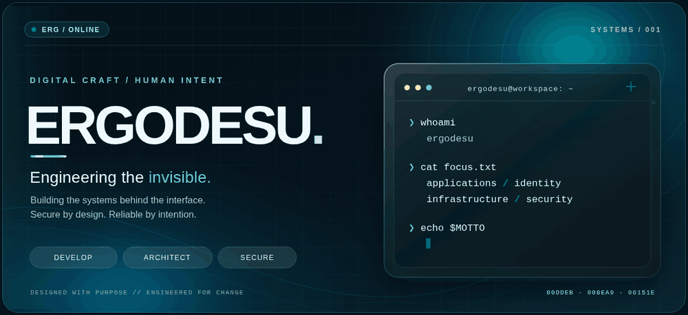
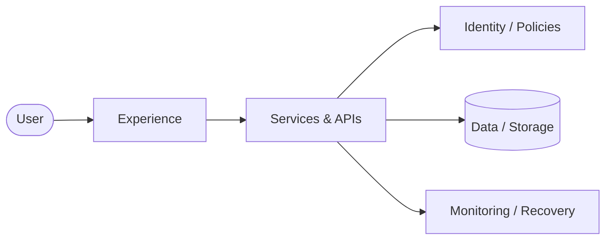

<!--
  ERGODESU / MOTION EDITION
  Colors: #00DDEB #008EA9 #006780 #EFF6FE #06151E #53E7F3
  Place this file at ergodesu/ergodesu/README.md
  Keep assets/ergodesu-motion.gif next to it.
  GIF animation renders on GitHub and does not require JavaScript or external hosting.
-->

<div align="center">
  
  <br/>
  <sub>ENGINEER BY INSTINCT · BUILDER BY CHOICE · BASED IN MONGOLIA</sub>
  <br/><br/>
  <a href="https://github.com/ergodesu?tab=repositories"><b>EXPLORE / WORK</b></a>&nbsp; · &nbsp;
  <a href="#the-stack"><b>STACK / SYSTEMS</b></a>&nbsp; · &nbsp;
  <a href="#protocols"><b>PROTOCOLS / DESIGN</b></a>&nbsp; · &nbsp;
  <a href="#classified"><b>CLASSIFIED / ???</b></a>
</div>

<br/>

<table>
  <tr>
    <td width="58%" valign="top">
      <h3>HELLO, WORLD<span>_</span></h3>
      <p>I’m <b>Ergodesu</b>. I build the systems behind the interface — from the first click to the infrastructure that keeps it alive.</p>
      <p>My playground is where <b>software engineering</b>, <b>identity</b>, <b>security</b>, and <b>operations</b> intersect.</p>
      <p><sub>Simple on the surface. Intentional underneath.</sub></p>
    </td>
    <td width="42%" valign="top">
      <h3>RUNTIME / PROFILE</h3>
      <pre><code>const engineer = {
  id: 'ergodesu',
  focus: ['build', 'secure',
          'operate', 'improve'],
  default: 'keep learning'
}</code></pre>
    </td>
  </tr>
</table>

<div align="center">
  <a href="https://git.io/typing-svg"></a>
</div>

## THE STACK

<table>
  <tr>
    <td width="50%" valign="top">
      <h3>◈ &nbsp; 01 / APPLICATIONS</h3>
      <p>Interfaces, APIs, services, integrations, automation.</p>
      <p><code>Next.js</code> <code>React</code> <code>Python</code> <code>Flask</code> <code>.NET</code></p>
    </td>
    <td width="50%" valign="top">
      <h3>⬡ &nbsp; 02 / IDENTITY</h3>
      <p>SSO, authentication, permissions, access boundaries.</p>
      <p><code>Keycloak</code> <code>OIDC</code> <code>OAuth2</code> <code>RBAC</code></p>
    </td>
  </tr>
  <tr>
    <td width="50%" valign="top">
      <h3>⌘ &nbsp; 03 / INFRASTRUCTURE</h3>
      <p>Linux, containers, deployment, monitoring, recovery.</p>
      <p><code>Ubuntu</code> <code>Docker</code> <code>Nginx</code> <code>Git</code></p>
    </td>
    <td width="50%" valign="top">
      <h3>◇ &nbsp; 04 / DATA & SYSTEMS</h3>
      <p>Databases, storage, migrations, legacy modernization.</p>
      <p><code>PostgreSQL</code> <code>SQL</code> <code>SeaweedFS</code> <code>Odoo</code></p>
    </td>
  </tr>
</table>

<div align="center">
  
  <br/><sub>Tools change. Engineering principles should survive the upgrade.</sub>
</div>

<br/>


### SIGNAL / RECENT ACTIVITY

<div align="center">
  
</div>

## PROTOCOLS

| `01` THINK IN SYSTEMS | `02` DEFEND THE EDGES | `03` PLAN TO RECOVER |
| :--- | :--- | :--- |
| Architecture is more than a diagram. | Security belongs in the design. | A backup is a promise you must test. |

<details>
<summary><b>⌁ EXPAND / SYSTEM MAP</b></summary>



<sub>A simplified philosophy, not an actual production topology.</sub>
</details>

## CLASSIFIED

<details>
<summary><b>⟡ OPEN / TRANSMISSION</b></summary>

```text
┌─ TRANSMISSION 40K.001 ──────────────────────┐
│ source     : ergodesu                       │
│ clearance  : TECH-ADEPT                     │
│ objective  : appease the machine spirit     │
│ status     : backups verified [hopefully]  │
└─────────────────────────────────────────────┘

> FOR THE EMPEROR.
> ALSO, WRITE DOCUMENTATION.
```

Outside the terminal: **Interstellar**, **Warhammer 40K**, **Metallica**, **Rammstein**, **Otyken**, games and cats.
</details>

<br/>

<div align="center">
  <a href="https://github.com/ergodesu?tab=repositories"></a>
  <br/><br/>
  <sub><b>ERGODESU</b> / Engineering the invisible · Build beyond the demo.</sub>
</div>
